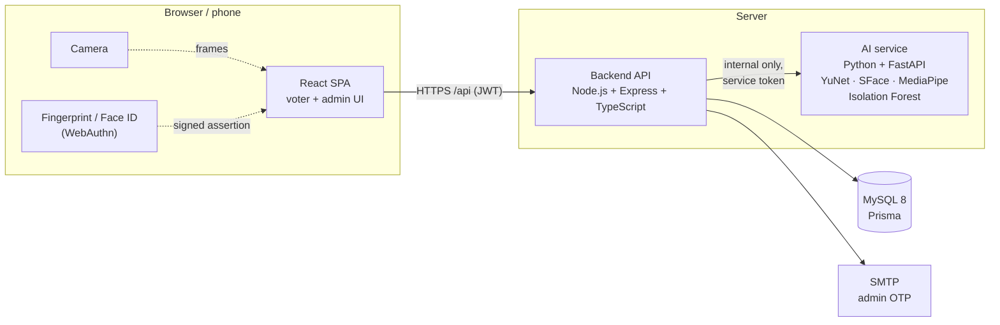

# Smart E-Voting System

Secure web-based voting with **face recognition + liveness detection**, **device-bound fingerprint
verification (WebAuthn)**, **secret ballots** and **AI-assisted fraud detection**.

Final Year Project **FYP-F25-05**, Department of Software Engineering, The University of Lahore.


---

## Why

Paper and password-based voting suffers from impersonation, multiple voting and slow, opaque
counting. This system verifies **who** is voting with two biometric-backed factors, guarantees
**one person, one vote** at the database level, and keeps **how** they voted secret — while giving
administrators a tamper-evident record of everything that happened.

## Features

**For voters**
- Register with name, CNIC and a **live face check**: blink and turn your head in a random order,
  so a photo or a replayed video is refused. A face that already belongs to another voter is
  rejected and flagged.
- Sign in with **CNIC → face → fingerprint / Face ID / screen lock** on your own phone or laptop
  (WebAuthn). No passwords.
- Vote once per election, review before confirming, see your voting history (never your choice)
  and published results with charts.
- Works on phones; keyboard and screen-reader accessible (checked with axe).

**For administrators**
- Sign in with password + emailed one-time code.
- Create elections and candidates; schedule → open → close → publish.
- Live **turnout** while voting; per-candidate results only after close (no influence on voters
  still to vote).
- Approve, suspend and unlock voters; handle lost-device requests.
- **Fraud alerts**: rule-based detection (repeated face failures, many accounts on one device,
  duplicate faces, cloned authenticators, double voting) plus an Isolation Forest anomaly score.
- **Audit log** hash-chained with SHA-256, with one-click integrity verification.
- Tunable thresholds (face match, liveness, lockout) from the settings page.

## How it protects the vote

| Threat | Defence |
|---|---|
| Someone votes as another person | Live face match (1:1) **and** a WebAuthn signature from the voter's own registered device |
| Photo, screen or video of the voter | Server-signed, single-use liveness challenge; same identity required on every frame |
| One person registers twice | 1:N face search at registration; duplicate → HIGH alert and account lock |
| Voting twice (even in parallel) | Primary key on `Participation(voter, election)` inside the vote transaction |
| Linking a voter to their choice | Ballots are stored with a random id, no voter id and no timestamp |
| Stolen face template | AES-256-GCM encryption, bound to the voter id |
| Phishing / cloned authenticator | WebAuthn origin + RP ID checks; signature counter regression → HIGH alert |
| Tampering with records | Hash-chained audit log; verification pinpoints the broken row |
| Votes landing after close | Tally computed inside the close transaction under a row lock |

Full OWASP Top 10 review and residual risks: [docs/security-review.md](docs/security-review.md).

## Architecture



The browser talks only to the backend. The AI service is internal, never sees voter identities and
never touches the database. More diagrams (sequences, ERD, state machines, deployment):
[docs/architecture.md](docs/architecture.md).

| Folder | What | Port |
|---|---|---|
| [`frontend/`](frontend) | React + Vite + TypeScript + Tailwind (voter and admin UI) | 5173 |
| [`backend/`](backend) | Node.js + Express + TypeScript + Prisma REST API | 4000 |
| [`ai-service/`](ai-service) | Python + FastAPI: face enrol/verify, liveness, fraud scoring | 8001 |
| [`docs/`](docs/README.md) | API reference, architecture, design decisions, security, evaluations | — |

## Results

| Measure | Result |
|---|---|
| Face verification on LFW (SFace, threshold 0.363) | **FAR 0 %**, FRR 2.6 % — [details](docs/face-evaluation.md) |
| Fraud anomaly model (synthetic hold-out, threshold 0.6) | precision 93.0 %, recall 74.8 % — [details](docs/fraud-detection.md) |
| Load test: 500 voters, 50 concurrent | 500 ballots, 0 duplicates, 0 errors |
| Concurrency: 10 simultaneous votes by one voter | exactly 1 ballot |
| Automated tests | backend 216 · frontend 40 unit + 32 browser (phone & desktop) · AI service 55 |

## Quick start

**Prerequisites:** Node.js 22.9+, Python 3.12, MySQL 8 (Docker or local install), a webcam, and a
device with fingerprint / Face ID / screen lock.

```bash
git clone <this repo> && cd Voting_System
cp .env.example .env              # replace every CHANGE_ME (DB password appears in 3 places)
docker compose up -d              # MySQL 8 — or use a local install, see below
```

<details>
<summary>Local MySQL instead of Docker</summary>

As root (use your `.env` password):

```sql
CREATE DATABASE evoting CHARACTER SET utf8mb4;
CREATE DATABASE evoting_test CHARACTER SET utf8mb4;
CREATE USER 'evoting'@'localhost' IDENTIFIED BY 'your-password';
GRANT ALL PRIVILEGES ON evoting.* TO 'evoting'@'localhost';
GRANT ALL PRIVILEGES ON evoting_test.* TO 'evoting'@'localhost';
-- needed by `prisma migrate dev` (shadow database):
GRANT ALL PRIVILEGES ON `prisma\_migrate\_shadow\_db%`.* TO 'evoting'@'localhost';
GRANT CREATE, DROP ON *.* TO 'evoting'@'localhost';
```

Windows without admin rights: see the portable MySQL steps in [docs/setup.md](docs/setup.md#3-database).
</details>

Then, in three terminals:

```bash
# 1. Backend — http://localhost:4000/api/health
cd backend
npm install                       # also generates the Prisma client
npm run db:deploy                 # apply migrations
npm run db:seed                   # first admin from ADMIN_SEED_* in .env
npm run dev

# 2. AI service — http://localhost:8001/health
cd ai-service
python -m venv .venv
.venv/Scripts/activate            # macOS/Linux: source .venv/bin/activate
pip install -r requirements-dev.txt
python scripts/download_models.py         # ~43 MB, checksum-verified
python scripts/generate_synthetic.py      # trains the fraud anomaly model
uvicorn app.main:app --env-file ../.env --port 8001

# 3. Frontend — http://localhost:5173 (admin area at /admin)
cd frontend
npm install
npm run dev
```

In development, admin login codes are written to `backend/.dev-mail/` instead of being emailed.
A step-by-step demo of every use case and a troubleshooting table are in
[docs/setup.md](docs/setup.md). Testing on real phones (HTTPS tunnel): [docs/mobile-testing.md](docs/mobile-testing.md).

## Tests and checks

| | Tests | Lint | Format | Types / build |
|---|---|---|---|---|
| `backend/` | `npm test` (needs MySQL + `evoting_test`) | `npm run lint` | `npm run format:check` | `npm run build` |
| `backend/` | `npm run load-test -- 500 50` | | | |
| `frontend/` | `npm test` · `npm run test:e2e` (first `npx playwright install chromium`) | `npm run lint` | `npm run format:check` | `npm run build` |
| `ai-service/` | `pytest` | `ruff check .` | `ruff format --check .` | — |

Backend tests run against a real MySQL database and a software WebAuthn authenticator with real
P-256 keys; they include seeded fuzzing of the JSON and query inputs.

## Documentation

| Document | What it covers |
|---|---|
| [Project brief](PROJECT_BRIEF.md) | scope, stack, rules and build phases |
| [Setup guide](docs/setup.md) | configuration, database options, demo walkthrough, troubleshooting |
| [API reference](docs/api.md) | every endpoint, auth, errors, the internal AI service |
| [Architecture](docs/architecture.md) | component, sequence, ER, state and deployment diagrams |
| [Design decisions](docs/design-decisions.md) | deviations from the proposal and why |
| [Security review](docs/security-review.md) | OWASP Top 10, fixes, residual risks, load test |
| [Face recognition accuracy](docs/face-evaluation.md) | LFW benchmark, FAR/FRR |
| [Fraud detection](docs/fraud-detection.md) | rules, anomaly model and metrics |
| [Testing on phones](docs/mobile-testing.md) | HTTPS tunnel, Chrome/Safari checklist |

## Limitations

- Liveness detection is a challenge-response check, not certified presentation-attack detection.
- The fraud model is trained on synthetic data, so it only raises alerts and never blocks anyone.
- MySQL's binary log can link a participation to its ballot; production deployments should follow
  the mitigation in the [security review](docs/security-review.md).
- Designed as a single-instance deployment (in-memory rate limiter).

## Team

- **Aisha Ishfaq** and **Zainab Noor**: developers
- **Muhammad Rizwan Amin**: advisor

Department of Software Engineering, The University of Lahore.

## Security

Secrets live only in `.env` (git-ignored); `.env.example` documents every variable. The AI service
must never be exposed outside the internal network. Please report vulnerabilities privately rather
than in a public issue.
