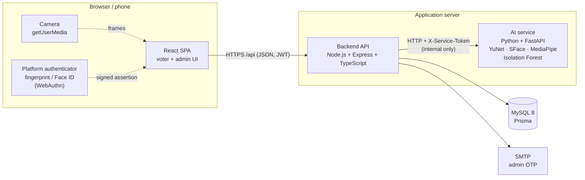
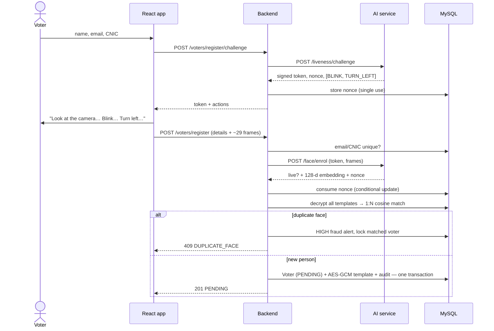
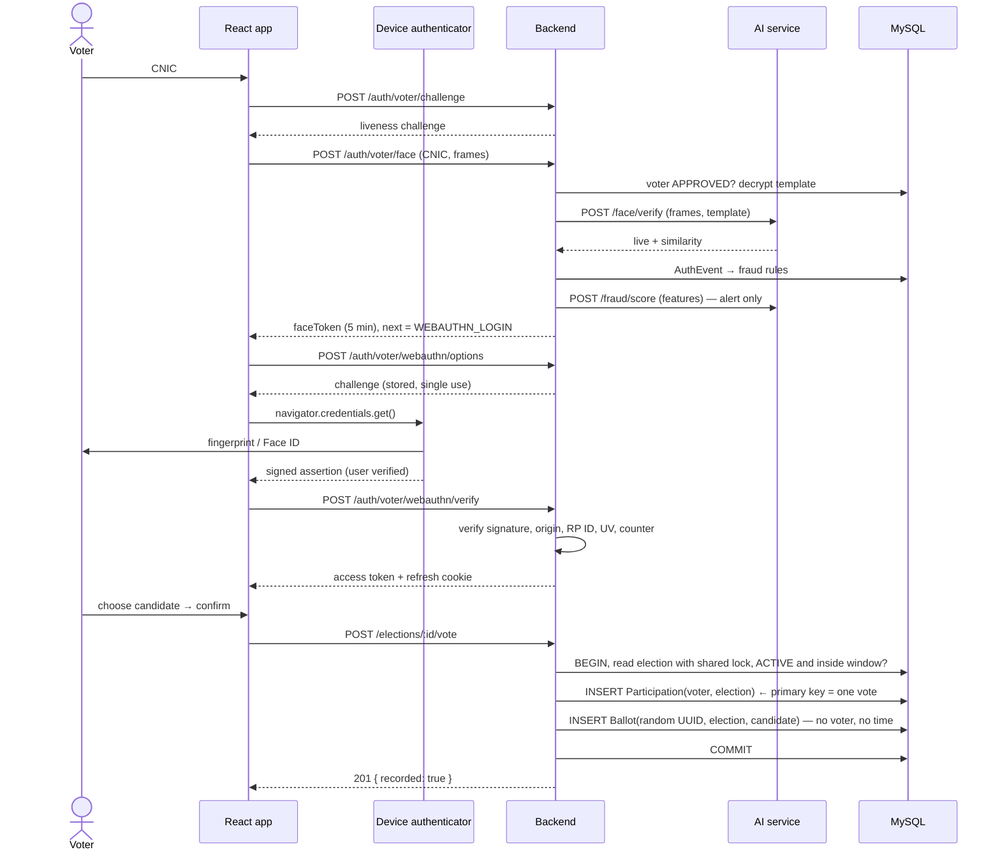
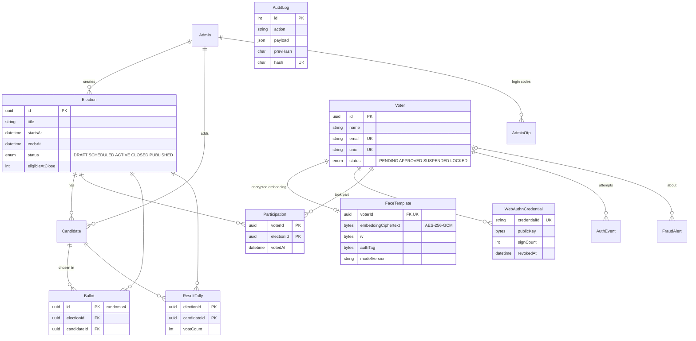
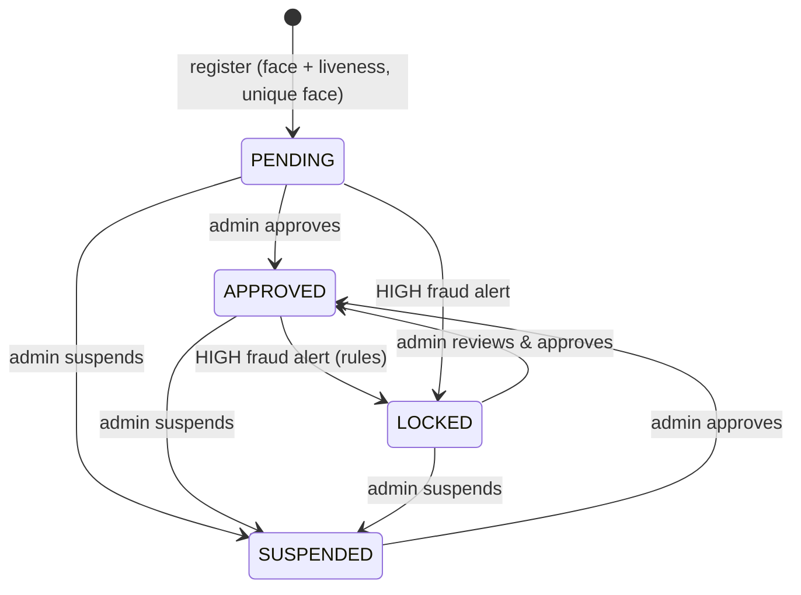
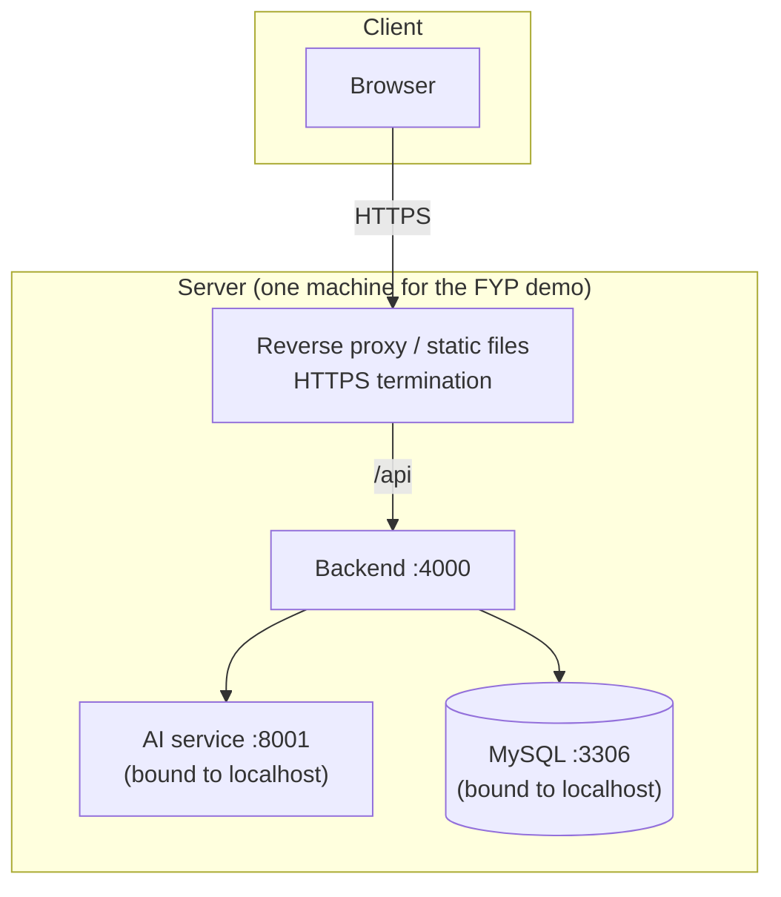

# Architecture

These diagrams describe the system as built. They can replace Figures 4.1 (architecture), 4.2
(ERD), 4.7 (sequence) and 4.9 (state) in the FYP report. All are Mermaid; they render on GitHub,
or paste them into <https://mermaid.live> to export images.

## Components (replaces Fig 4.1)

The browser talks only to the backend. The AI service is reachable only from the backend, with a
shared service token. The AI service never sees voter identities, only frames and embeddings, and
it never touches the database.

Backend modules (`backend/src/modules/`):

| Module | Responsibility | UC |
|---|---|---|
| `auth` | admin password + OTP, voter face step, WebAuthn, sessions | UC-02 |
| `voters` | registration, admin voter management, recovery requests, `/me` | UC-01, UC-07, UC-10 |
| `face` | liveness challenges (single-use), 1:N face search | UC-01, UC-02 |
| `elections` | lifecycle state machine, candidates | UC-08, UC-09 |
| `voting` | ballot, transactional vote, published results | UC-03…UC-06 |
| `results` | tally on close, turnout, consistency check | UC-12, UC-13 |
| `fraud` | rules engine, anomaly scoring hook, alert review | UC-11, UC-15…UC-18 |
| `audit` | hash-chained append-only log + verification | UC-12 |
| `settings` | tunable thresholds | UC-14 |

## Registration (UC-01)

## Sign-in and voting (replaces Fig 4.7)

## Data model (replaces Fig 4.2)

`Participation` and `Ballot` deliberately share no key and no timestamp. The proposal's single
`VOTE(voter_id, candidate_id, vote_time)` table would reveal how everyone voted (deviation D2).
Supporting tables not drawn: `AuditChainHead`, `SystemSetting`, `RefreshToken`,
`LivenessChallenge`, `WebAuthnChallenge`, `RecoveryRequest`.

## Election lifecycle

```mermaid
stateDiagram-v2
  [*] --> DRAFT: create
  DRAFT --> SCHEDULED: schedule (≥ 2 candidates)
  SCHEDULED --> ACTIVE: open
  ACTIVE --> CLOSED: close (tally computed)
  CLOSED --> PUBLISHED: publish
  note right of DRAFT: candidates editable in DRAFT and SCHEDULED
  note right of ACTIVE: votes accepted only here, inside startsAt..endsAt;\nadmins see turnout only
```

## Voter states (replaces Fig 4.9)

"Has voted" is not a voter state. It's a `Participation` row per election, so voting in one
election doesn't affect others.

## Deployment (replaces Fig 4.12)

In development, the Vite dev server plays the reverse proxy role. For phones, an HTTPS tunnel
fronts it (see [mobile-testing.md](mobile-testing.md)).
